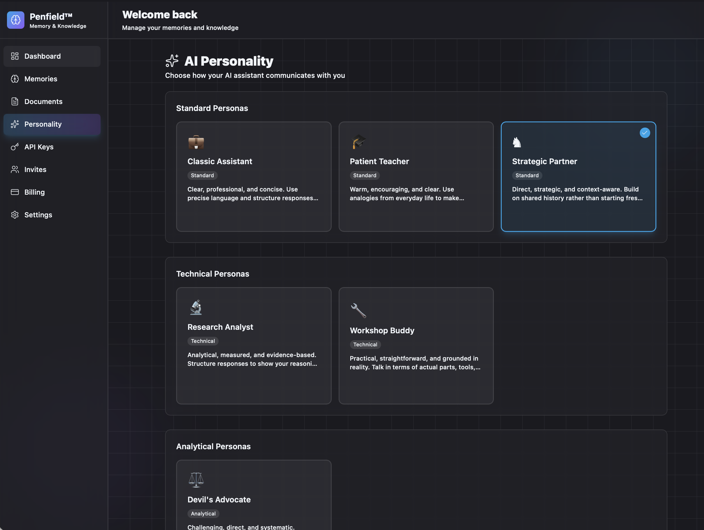
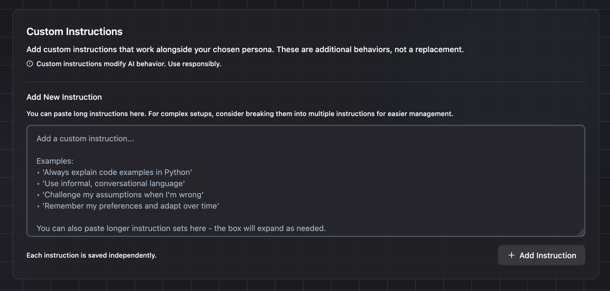

# Persona Templates for Penfield + OpenClaw

Penfield can supply identity, preferences and recent memories on eligible turns. Keep your current workspace files until you have verified the briefing in a real session. The templates show which files can then be reduced and how to preserve old memories.

## Where does the personality come from now?

Instead of editing static markdown files, you configure everything in the [Penfield portal](https://portal.penfield.app). Use these settings for the identity, voice and user preference files:

**1. Choose a base personality** at [portal.penfield.app/personality](https://portal.penfield.app/personality)

This is your starting point - a basic framework that sets what kind of assistant you're working with. Think of it as picking the foundation, not the finished product.

Change the base personality in the portal. A cached identity briefing can take up to 30 minutes to refresh.

**2. Fine-tune with custom instructions**

This is where the real personality lives. Everything that used to go in SOUL.md, IDENTITY.md, and USER.md - voice, identity, quirks, boundaries, user preferences, behavioral rules - is defined here through one or more custom instructions. You can add as many as you need, and this is where infinite fine-tuning happens. Add one monolithic block, or multiple individual rules; the choice is yours.

You can add, remove, or edit custom instructions in the portal. Preview the current briefing with `openclaw penfield awaken`.

## Setup order

1. Install with `openclaw plugins install npm:openclaw-penfield` and sign in with `openclaw penfield login`.
2. Choose your base personality and custom instructions in the portal. For verification, choose one harmless detail unique to the portal briefing.
3. Run `openclaw config set plugins.entries.openclaw-penfield.hooks.allowConversationAccess true` and restart the gateway. Automatic awaken requires this grant, `autoAwaken`, and permission to use `penfield_awaken` on the turn.
4. Run `openclaw penfield status` to check the login and hook grant. Preview the expected detail with `openclaw penfield awaken`. Start a fresh ordinary conversation, ask for that detail without naming it, and check that the response used it without an explicit tool call. Keep your identity files intact until this succeeds.
5. Disable built-in memory with `openclaw config set plugins.entries.memory-core.enabled false` and restart the gateway. Follow the [MEMORY.md migration steps](MEMORY.md) to archive the original in `history/openclaw-memory.md` before leaving a bare header.
6. Back up your identity files and review each remaining template individually. Remove old instructions to write daily notes from workspace guidance.

## File Reference

### Identity and preference headers

| File                       | What replaces it                                                      |
| -------------------------- | --------------------------------------------------------------------- |
| [IDENTITY.md](IDENTITY.md) | Custom instructions - name, identity, vibe, who you are               |
| [SOUL.md](SOUL.md)         | Custom instructions - voice style, quirks, boundaries, personality    |
| [USER.md](USER.md)         | Custom instructions - user preferences, context, and behavioral rules |

Each of these contains only `# FILENAME` - enough to prevent OpenClaw from injecting "missing file" markers, without wasting tokens on duplicate content.

### Keep with content (Penfield doesn't cover these)

| File                         | What it does                                                                                          |
| ---------------------------- | ----------------------------------------------------------------------------------------------------- |
| [AGENTS.md](AGENTS.md)       | Operational rules, safety boundaries, group chat protocols. Customize to your setup                   |
| [TOOLS.md](TOOLS.md)         | Local environment notes - device names, SSH hosts, non-Penfield plugin conventions                    |
| [HEARTBEAT.md](HEARTBEAT.md) | Periodic task checklist (runs every ~30 min). If effectively empty, OpenClaw skips heartbeat entirely |

These files contain safe defaults with HTML comments explaining what to keep, what to customize, and why. Read the comments before editing.

## Why empty, not delete?

OpenClaw injects a "missing file" marker for any deleted bootstrap file, which wastes tokens every session. An empty file with just the markdown header (`# SOUL`) avoids this cleanly.

### Why `# IDENTITY` not `# IDENTITY.md - Agent Identity`?

The `.md` extension and description suffix are scaffolding noise. Bare headers are cleaner and cost fewer tokens per session.
